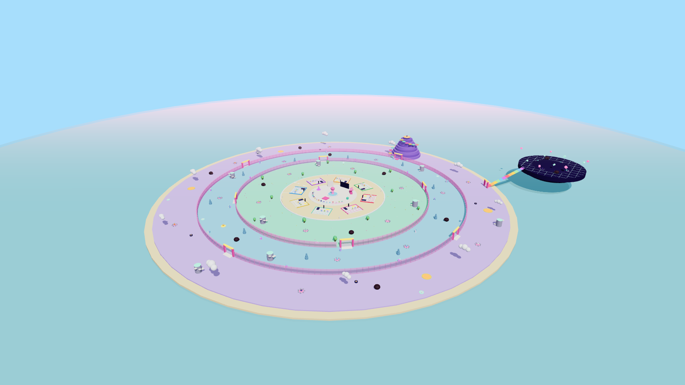
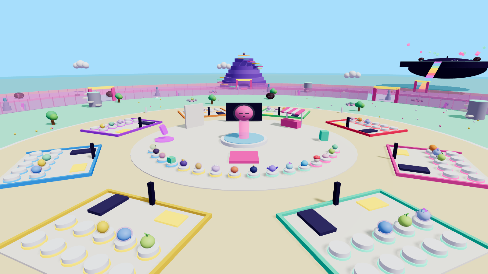
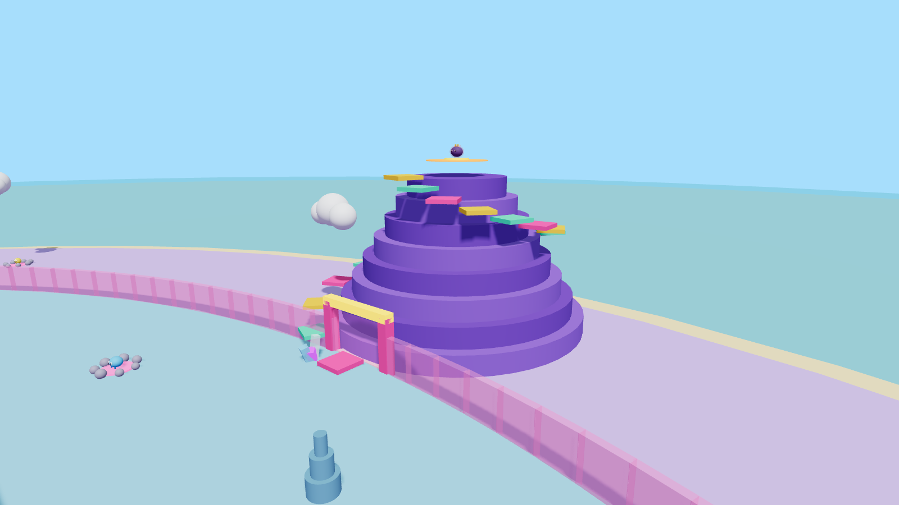
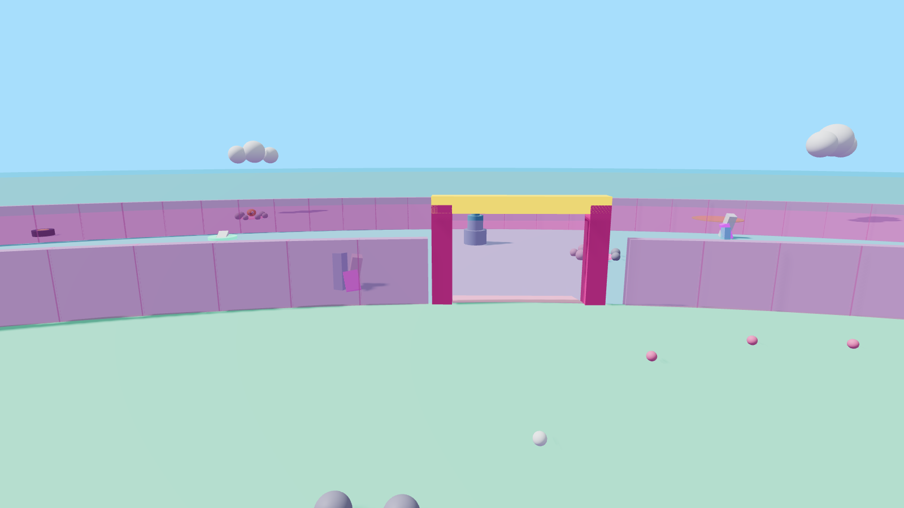
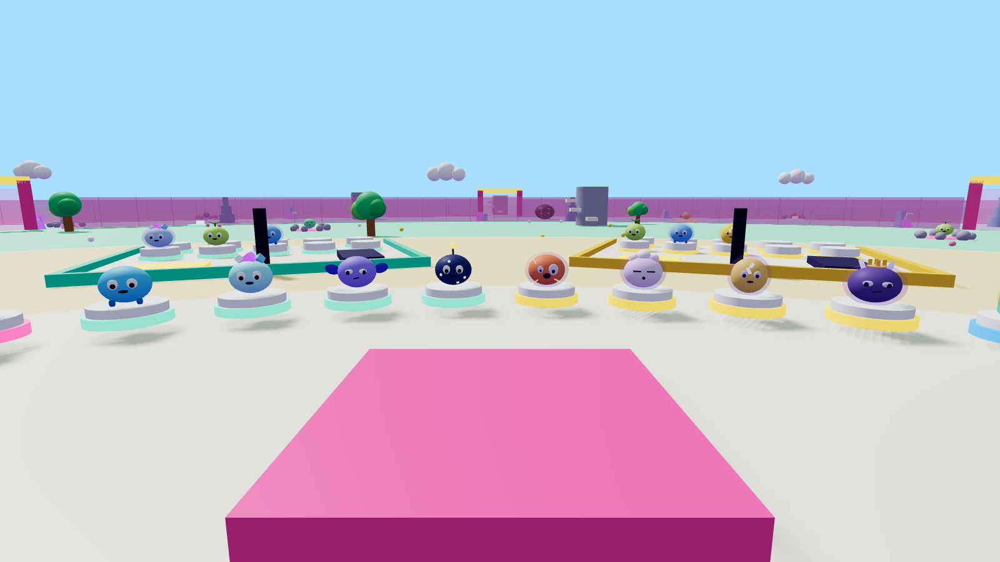
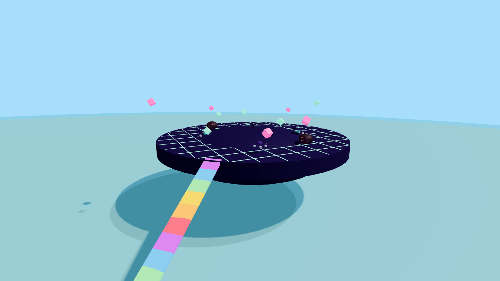

# 08. 3D-мир: остров, азарт, слаймы

Готовый плейс: **`place/GreedySlimes.rbxl`**. Открывается в Roblox Studio двойным кликом.
Его собирает код из `src/` командой `lune run tools/build_place.luau`, так что остров — это код, а не ручная расстановка. Любое изменение пересобирается за секунду.



## Устройство острова

| Кольцо | Радиус, studs | Высота пола | Что там |
|--------|---------------|-------------|---------|
| Площадь | 0–45 | 7.25 | Спавн, фонтан со статуей «Жадный», витрина-Индекс из 16 слаймов, магазин, табло обновлений, лидерборд «Самый жадный», алтарь ребёрта, коды |
| Кольцо баз | 45–95 | 7 | 8 плотов: 10 пьедесталов, касса, беговая дорожка, табличка. **Безопасно**: Прилив сюда не доходит |
| 1 · Желейный луг | 95–175 | 6 | 6 гнёзд, 3 Слаймоеда, 3 скалы-убежища, 2 батута, деревья, цветы |
| 2 · Кристальные пещеры | 175–240 | 5 | 6 гнёзд, 3 Слаймоеда, 3 скалы, 2 батута, кристаллы со светом, сталагмиты |
| 3 · Облачный вулкан | 240–310 | 4 | 6 гнёзд, 3 Слаймоеда, 3 скалы, 2 батута, лава, гейзеры, облака, **вулкан с Коронным гнездом** |
| 4 · Глитч-зона | летающий остров | 40 | 4 гнезда, 2 Слаймоеда, неоновая сетка. Радужный мост, ворота «Ребёрт 1 · Скорость 42» |

**Прилив работает физически.** Каждое кольцо на 1 stud ниже внутреннего. Прилив поднимает море до 6.6, оно заливает три зоны, а кольцо баз (7) остаётся сухим. В плейсе уже есть скрипт `TideDemo`: нажми Play, и через 150 секунд море поднимется.

## Что даёт азарт (как в Steal An Egg, но со своими фишками)

| Элемент | Как работает | Почему затягивает |
|---------|-------------|-------------------|
| **Слаймоеды у гнёзд** | Спят рядом с гнёздами («Zzz») и просыпаются, когда ты хватаешь слайма | Тот же страх погони, что и со Стражами в Steal An Egg: «успею или нет?» |
| **Узкие ворота** | Между зонами сплошная желейная стена и всего 4 прохода. Внутренние и внешние ворота смещены на 45°, путь домой идёт зигзагом | Все возвращаются через одни ворота, и там засады, шлепки и перехваты. Хочешь проскочить — выбираешь ворота, где никого нет |
| **Золотое гнездо** | Каждые 5 минут появляется в одном из 5 мест. Сервер объявляет об этом всем, над гнездом таймер | Гонка всего сервера в одну точку и толпа у гнезда — лучшие моменты для клипов |
| **Коронное гнездо** | На вершине вулкана, наверх ведёт желейный паркур из 18 ступенек. Перегрев здесь в 2 раза сильнее | Самый большой риск и самая большая награда. Того, кто туда полез, видно с любой точки карты |
| **Батуты «Домой»** | Подбрасывают к кольцу баз, но стоят рядом со Слаймоедами | Рискованный короткий путь: выигрыш во времени или потеря слайма |
| **Скалы-убежища** | Лесенка наверх, туда Прилив не достаёт | В последние секунды перед волной начинается толкотня «царь горы» |
| **Радужный мост** | Глитч-зону видно с самого начала, но пускает туда только ребёрт | Цель на горизонте, к которой хочется дорасти |
| **Витрина-Индекс на спавне** | Все 16 видов стоят на пьедесталах прямо там, где ты появляешься | Сразу видно, сколько всего можно собрать |
| **Лидерборд «Самый жадный»** | Рекорд по самому долгому удержанию | Статус: соревнуются не только деньгами, но и смелостью |

## Слаймы (16 видов, 4 на биом)

Строятся из обычных деталей Roblox (`src/shared/World/SlimeBuilder.luau`), загружать модели не нужно. Вид задаёт форму и цвет, редкость — свечение, ауру и лицо, скин — материал.

| Биом | Виды (шанс в гнезде 50 / 30 / 15 / 5%) |
|------|----------------------------------------|
| Луг | Blubby, Sprout (листик), Mochi (плоский), Shroomy (шляпка гриба) |
| Пещеры | Gloop (капли), Crystal Kiki (кристаллы), Bat Jelly (крылья), Glowy (антенна-лампочка) |
| Вулкан | Lava Lenny (трещины лавы), Cloudy (облако), Spark (молния), Obsidian Jellord (рога и корона) |
| Глитч | Pixel (кубический), Errorbyte (двоится), Voidy (галактика внутри), 404 (только контур) |

**Скины:**
- мутации: Gold ×2, Diamond ×3, Rainbow ×6, Galaxy ×15;
- ивентовые: Blood Moon ×4, Frozen ×3, Candy ×3.

**Лица:** сонный → довольный → самодовольный → безумный → глитч.







> Эти картинки — грубое превью из three.js, чтобы проверить расстановку. В Studio всё будет красивее: включены свет Future, Bloom, атмосфера, неон и надписи над объектами.

## Что уже работает и что дальше

**Уже есть:**
- весь остров;
- 65 моделей слаймов;
- Слаймоеды, ворота с атрибутами `RequiredSpeed`;
- гнёзда (`Nest`, `Zone`), батуты, скалы, Золотое и Коронное гнёзда;
- свет;
- скрипт Прилива.

**Ещё не программировали** (этап 1 и дальше):
- подбор и эволюция слайма в руках;
- шлепок;
- доход и касса;
- проверка скорости на воротах;
- пробуждение и погоня Слаймоедов;
- сохранения;
- HUD.

**Пересобрать остров прямо в Studio:**
```lua
require(game.ServerStorage.WorldTools.RebuildWorld)()
```
Можно ввести в командной строке Studio, или это сделаю я через MCP, когда подключишь Claude к Studio.

**Пересобрать файл здесь:**
```bash
lune run tools/build_place.luau place/GreedySlimes.rbxl /tmp/scene.json
node tools/preview/render.mjs /tmp/scene.json docs/img   # превью (нужны playwright и three)
```
