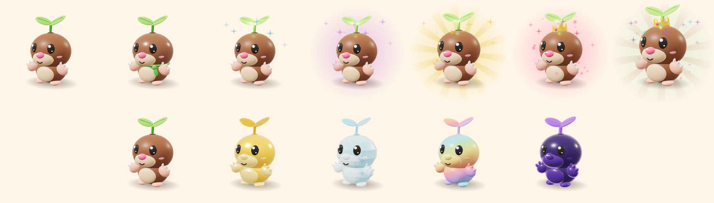
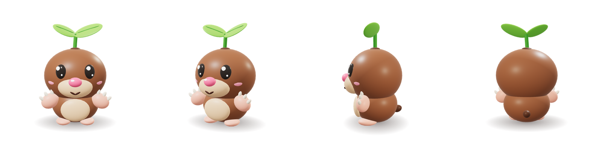

# Кротик-Росток

Питомец Dig an Egg. Пухлый крот-копатель с ростком на голове: какао-коричневая шёрстка, светлая мордочка,
розовый нос, большие розовые лапы-копалки с кремовыми коготками и ярко-зелёный двулистный росток —
одна яркая деталь, которая узнаётся с 50 studs.



| | |
|---|---|
| Планета | 🌱 Зелёная |
| Бонус спутника | ⛏️ Копатель |
| Размер | ~4.3 stud в высоту (Secret ×1.15) |
| Основной цвет / акцент | `#8f5b3d` шёрстка / `#74d63f` росток |
| Треугольники | ~10 700 на всю модель, 15 мешей (лимит Roblox — 20 000 на меш) |



## Файлы

| Файл | Что это |
|---|---|
| `KrotikRostok.luau` | ModuleScript: собирает 3D-модель из деталей прямо в Studio, включает редкости и мутации |
| `KrotikRostok.glb` | Готовый 3D-меш со всеми аксессуарами (шарф, корона), 1 единица = 1 stud |
| `KrotikRostok-Common.glb` | Тот же меш без аксессуаров |
| `KrotikRostok.obj` + `.mtl` | Запасной формат для Blender и других редакторов |
| `krotik-rostok.model.json` | Описание всех 43 деталей, палитры, редкостей и мутаций (из него собрано всё остальное) |
| `renders/*.png` | Иконки 512×512 на прозрачном фоне для инвентаря и магазина яиц |

## Способ 1. Luau-модуль (рекомендую)

Модель собирается из обычных Part + SpecialMesh, без загрузки ассетов, и сразу умеет все редкости и мутации.

1. В Studio: ReplicatedStorage → Insert Object → ModuleScript, назови `KrotikRostok`, вставь код из `KrotikRostok.luau`.
2. Витрина всех вариантов — в Command Bar (View → Command Bar):
   ```lua
   require(game.ReplicatedStorage.KrotikRostok).Showcase(workspace)
   ```
   Появятся 7 редкостей в ряд и 4 мутации во втором ряду, с подписями.
3. В игре:
   ```lua
   local Krotik = require(game.ReplicatedStorage.KrotikRostok)
   local pet = Krotik.Build("Legendary", "Gold")   -- редкость, мутация
   pet:PivotTo(CFrame.new(0, 0, 0))                 -- точка опоры = под лапами, смотрит по LookVector
   pet.Parent = workspace

   Krotik.SetRarity(pet, "Mythic")
   Krotik.SetMutation(pet, "Rainbow")
   local stop = Krotik.StartRainbow(pet)           -- переливы для Rainbow, лучше в LocalScript
   ```
   Модель: невидимый `Root` (PrimaryPart) и детали, приваренные к нему, без коллизий, `Massless`.
   Атрибуты на модели: `Pet`, `Planet`, `Bonus`, `Rarity`, `Mutation`, `Multiplier`.

## Способ 2. Готовый меш .glb

1. File → Import 3D → `KrotikRostok.glb`. Scale Unit оставь **Stud**: модель встанет ростом ~4.4 stud.
2. Получится Model из 15 MeshPart с именами по ролям: `Fur`, `Face`, `Paw`, `Claw`, `Nose`, `Eye`, `Leaf`,
   `Scarf`, `Crown` и т.д.
3. Чтобы включить редкость и мутацию у импортированной модели:
   ```lua
   local Krotik = require(game.ReplicatedStorage.KrotikRostok)
   Krotik.Adopt(workspace.KrotikRostok, "Epic", "Diamond")
   ```
   `Adopt` добавит `Root`, сварит детали, спрячет лишние аксессуары и раскрасит модель.

Если после импорта питомец смотрит назад — поверни его на 180° в окне Import Preview (glTF смотрит в +Z).

## Редкость — видна без текста

| Редкость | На модели | Эффект в Roblox |
|---|---|---|
| Common | как есть | — |
| Uncommon | шарфик из листа, лёгкий блеск шёрстки | Reflectance 0.08 |
| Rare | листья светятся (Neon) | искры цвета `#3fa9ff`, свет от ростка |
| Epic | + фиолетовая аура | большая вращающаяся звезда-аура, искры `#b670ff`, PointLight |
| Legendary | + золотые лучи, ×1.05 | вращающиеся лучи, золотые искры, PointLight |
| Mythic | + золотая корона, ×1.05 | розовая аура, частицы летят вверх |
| Secret | + корона, радужное сияние, ×1.15 | радужные лучи и частицы, космические звёзды |

## Мутации — тот же питомец, другой материал

Глаза, блики и рот не меняются никогда, чтобы мордочка читалась на любом материале.

| Мутация | Множитель | Как выглядит |
|---|---|---|
| Gold | ×2 | всё тело из полированного золота `#ffc436`, блики |
| Diamond | ×3 | голубой кристалл `#8fdfff`, Glass, полупрозрачный |
| Rainbow | ×6 | пастельная радуга снизу вверх, `StartRainbow` пускает переливы |
| Galaxy | ×15 | тёмно-фиолетовый космос `#2d1458`, светящийся контур (Highlight `#b98cff`), звёзды |

Galaxy использует `Highlight`. В Roblox одновременно видно не больше 31 Highlight, поэтому при толпе питомцев
включай контур только у ближайших.

## Промты для генераторов

Если захочешь перегенерировать Кротика в Midjourney, ChatGPT или Roblox Assistant — промты собраны по
документу «Питомцы Dig an Egg». Рендеры из `renders/` можно приложить как референс.

**Питомец (вставлять после базового стиля):**
```
chubby baby mole with soft cocoa-brown fur, light tan muzzle and belly, round pink nose,
big pink digging paws with tiny cream claws, a bright green two-leaf sprout growing from the top of its head
```

**Полный промт, Common:**
```
Cute chibi pet for a Roblox pet game, in the style of Pet Simulator 99 and Adopt Me,
simple stylized low-poly 3D, chunky rounded body, oversized head, big glossy eyes with
white highlights, small happy mouth, bright saturated colors, smooth plastic material,
soft studio lighting, clean silhouette readable from far away, 3/4 front view,
full body, centered, plain white background, no text, no logo,
chubby baby mole with soft cocoa-brown fur, light tan muzzle and belly, round pink nose,
big pink digging paws with tiny cream claws, a bright green two-leaf sprout growing from the top of its head,
plain, simple, no effects
```

**Короткий, для generate_mesh:**
```
chubby baby mole with cocoa-brown fur, pink nose, big pink digging paws, green two-leaf sprout on its head, cute chibi low-poly Roblox pet
```

**Добавки по редкости** (в конец полного промта вместо `plain, simple, no effects`):

| Редкость | Добавка |
|---|---|
| Uncommon | `small accessory, slight shine, tiny green leaf scarf around the neck` |
| Rare | `glowing accents, light sparkle, softly glowing sprout leaves` |
| Epic | `glowing purple aura, floating sparkles` |
| Legendary | `golden glowing aura, light rays, majestic pose` |
| Mythic | `intense red-pink aura, floating particles, epic pose, small golden crown` |
| Secret | `rainbow glitch aura, cosmic particles, legendary boss presence, slightly bigger` |

Мутации — добавки из документа без изменений: Gold `entire body made of shiny polished gold, metallic reflections`,
Diamond `entire body made of translucent light-blue diamond crystal, facets, sparkles`,
Rainbow `body with smooth rainbow gradient, glowing pastel colors`,
Galaxy `body is dark purple space with stars and nebula inside, glowing outline`.

## Как пересобрать

Все файлы собираются из одного описания в `tools/pet-builder/build_model.py`:

```bash
pip install numpy
python tools/pet-builder/build_model.py pets/KrotikRostok
```

Меняешь размеры, цвета или детали в `build_model.py` — заново получаешь `.glb`, `.obj`, `.luau` и `.model.json`.
Сгенерированную часть `KrotikRostok.luau` (между `BEGIN GENERATED` и `END GENERATED`) руками не правь.
